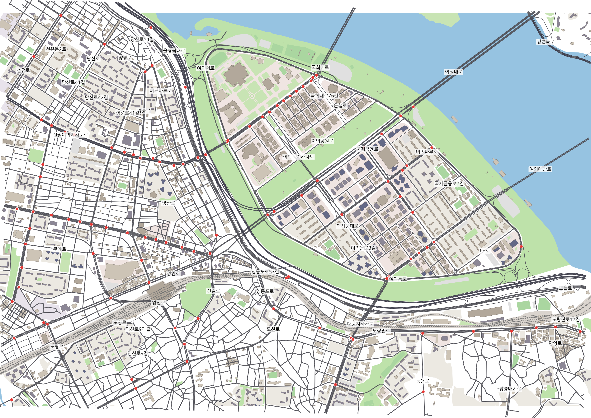
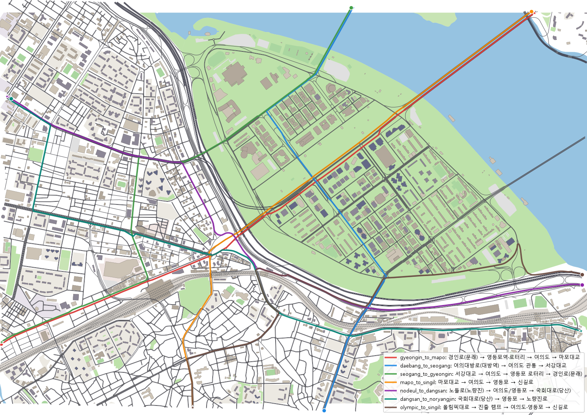
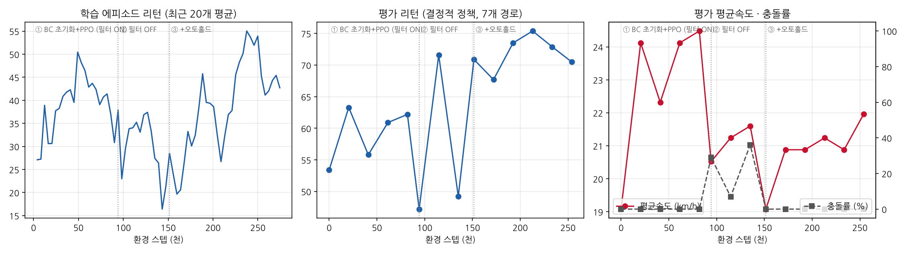
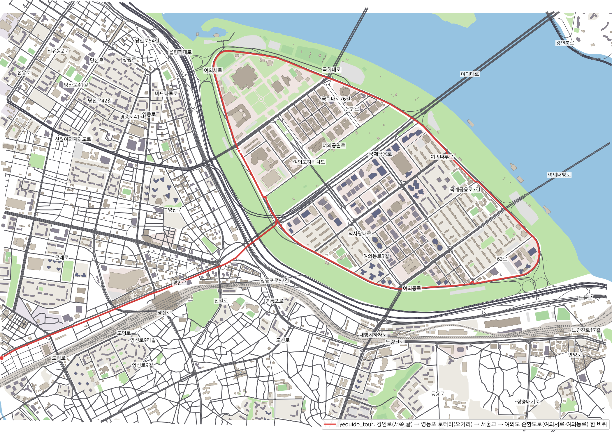

# 영등포 ~ 여의도 실도로 SUMO 자율주행 환경

> 자율주행 인공지능 및 제어 — 팀 프로젝트 (AI_sapiens)
> **"서울 영등포 로터리 · 여의도 교량 · 신호교차로 106곳이 얽힌 실제 도시망에서, 일반 차량 수천 대 사이를 AV가 출발지부터 목적지까지 스스로 주행한다."**



## 1. 왜 이 지역인가

| 구조 | 실제 위치 | AV가 해야 하는 의사결정 |
|---|---|---|
| 회전교차로 → 평면 신호교차로 (2024 평면화) | 영등포 로터리 (11개 OSM 점을 1개 교차로로 병합) | 다방향 진입 차량과 상충, 출구 차선 선택 |
| 교량 진입·진출 | 서울교 · 여의교 · 마포대교 · 서강대교 | 교량 끝 신호교차로 직전 차로 합류/분기 |
| 도시고속도로 램프 | 올림픽대로 · 노들로 진출입 | 고속(80 km/h) → 도심(50 km/h) 감속, 램프 합류 |
| 입체 교차 | 여의대방로 고가, 여의교·대방·여의도 지하차도 | 같은 도로명이라도 층이 다른 경로 구분 |
| 다차로 간선 + 이면도로 격자 | 여의대로(편도 4~5), 경인로, 국회대로 | 회전 전 차로 확보, 느린 차 추월, 신호 대기열 |

AV 과제는 영역 경계에서 경계로 나가는 **실제 통행 OD 7개** (3.5~4.9 km, 신호 6~33곳):

| id | 경로 | 길이 | 신호 |
|---|---|---:|---:|
| gyeongin_to_mapo | 경인로(문래) → 영등포역·로터리 → 여의도 → 마포대교 | 4.50 km | 16 |
| daebang_to_seogang | 여의대방로(대방역) → 여의도 관통 → 서강대교 | 3.49 km | 15 |
| seogang_to_gyeongin | 서강대교 → 여의도 → 영등포 로터리 → 경인로 | 3.77 km | 31 |
| mapo_to_singil | 마포대교 → 여의도 → 영등포 → 신길로 | 4.04 km | 10 |
| nodeul_to_dangsan | 노들로(노량진) → 여의도/영등포 → 국회대로(당산) | 4.91 km | 19 |
| dangsan_to_noryangjin | 국회대로(당산) → 영등포 → 노량진로 | 4.76 km | 33 |
| olympic_to_singil | 올림픽대로 → 진출 램프 → 여의도·영등포 → 신길로 | 4.78 km | 6 |



## 2. 구성

```
ydp-yeouido/
├─ env/
│  ├─ road_config.py     도로·교통 설정 (source of truth): 영역, 국내 제한속도/차로 기본값, OSM 보정,
│  │                     교차로 병합, 신호, HV 컨트롤러 믹스, AV 과제 OD
│  ├─ road_builder.py    OSM → netconvert 2단계 → 신호(Webster+연동) → 건물 → 교통 → AV 경로
│  ├─ osm_prep.py        OSM 클리핑 · 건물/한강 multipolygon 조립
│  ├─ mdp_config.py      AV POMDP 정의 (관측 44차원 / 행동 2차원 / 보상)
│  ├─ sumo_env.py        Gymnasium 환경 (YdpCityEnv) — 스냅샷 reset, 신호·경로 관측, 안전 게이트
│  └─ sumo/              생성된 SUMO 파일 (ydp.net.xml, ydp.rou.xml, ydp.tls.xml, ydp.poly.xml, …)
├─ expert_policy.py      규칙 기반 전문가 (IDM + 신호 정지 + 추월) — BC 교사
├─ algorithms/, utils/   수업 제공 PPO / BC / 네트워크 / 평가 / 로거 (그대로 사용)
├─ train.py              PPO 학습 (BC warm start → 미세조정, best 체크포인트)
├─ train_bc.py           Behavior Cloning (수업 코드 그대로)
├─ evaluate.py           100 에피소드 평가 (충돌률 / 완주율 / 경로별)
├─ collect_pomdp_data.py POMDP 데이터 수집 (수업 필수 컬럼 + 도시망 확장, 병렬)
├─ view_road.py          sumo-gui 도로 확인 (수업 view_road.py 대응)
├─ tools/                fetch_osm · render_map · stability_test · fidelity_check · jam_map ·
│                        record_video · upload_hf
├─ docs/                 dataset_card.md (HuggingFace README)
└─ results/final/        최종 모델 · 평가 결과
```

## 3. 실행

```bash
pip install -r requirements.txt            # SUMO는 eclipse-sumo(pip) 또는 설치본 + SUMO_HOME
python tools/fetch_osm.py                  # data/osm/region.osm 이 있으면 건너뜀
python -m env.road_builder                 # 도로·신호·건물·교통·AV 경로 생성 (~30 s)
python view_road.py                        # sumo-gui로 확인 (--av gyeongin_to_mapo: AV 함께)

python tools/stability_test.py --end 4800 --step 0.5 --hotspots   # HV 안정성 (텔레포트·충돌·정체)
python tools/fidelity_check.py             # OSM 대비 도로 일치도

python collect_pomdp_data.py --policy expert --episodes 140 --workers 4 --expert-noise 0.1 --name expert_train
python train_bc.py --data data/expert_train.npz            # BC
python train.py --bc-data data/expert_train.npz --timesteps 200000 --run-name final   # PPO
python evaluate.py --model results/final/model.pt --episodes 100 --workers 4
python tools/record_video.py --model results/final/model.pt --route gyeongin_to_mapo   # 주행 영상
python collect_pomdp_data.py --model results/final/model.pt --episodes 7000 --workers 8 --no-jsonl
python tools/upload_hf.py --repo <hf-id>/ydp-yeouido-av --files "data/*.npz" "data/*.jsonl.gz"
```

## 4. 도로 환경 — 실제 도로 일치도와 시뮬레이션 안정성

**일치도 (OSM 대비, `tools/fidelity_check.py`)**: 도로 포함 97.8 % · 선형 오차 중앙값 0.01 m(99 % 4.8 m) ·
차로 수(태그 구간) 99.5 % · 제한속도 100 % · 입체 교차 오류 0건.
한계: OSM에 차로 수가 없는 간선 214 km는 등급별 추정값, 회전 제한은 미반영(수집 쿼리 수정 완료, 로컬 재수집 필요),
신호 107곳 중 72곳은 추정 신호(실제 운영 데이터 아님).

**HV 교통 안정성 (`tools/stability_test.py`, 80분 = 수요 60분 + 해소 20분, 0.5 s step)**

| 설정 | 수요 | 텔레포트 | HV 충돌 | 종료 시 잔류 | 평균속도 |
|---|---:|---:|---:|---:|---:|
| 교차로 병합 + Webster 신호 (이전 세션 최종) | 6,546 대/h | 255 | 59 | 342 | 17.8 km/h |
| + 60 s 동적 재경로 · 충돌 차량 제거 | 6,546 대/h | 28 | 41 | 0 | 26.6 km/h |
| + 보호좌회전 · 고속 비보호좌회전 금지 · 영중로×문래로 신호 | 6,546 대/h | 19 | 35 | 0 | 26.5 km/h |
| **최종 (seed 42 / 1 / 2 / 3)** | **7,200 대/h** | 28 / 43 / 33 / 41 | 53 / 59 / 51 / 41 | 2 / 2 / 0 / 0 | 25.7~26.1 km/h |

HV 충돌은 7,200대 중 0.6~0.8 %이며 대부분 교차로 내부 저속 접촉(SUMO 교차로 모델 한계). 8,000 대/h부터 텔레포트가 급증해 7,200을 채택.

## 5. AV POMDP

- **관측 44차원** (`env/mdp_config.py`): 수업 31차원(속도, 5개 차선 선·후행, 차선 밀도) + 차선별 경로 지속 거리,
  다음 신호 거리·상태·남은 시간, 다음 교차로 거리·우선권, 필요 차선변경 수·남은 거리, 가속도, 현재/다음 제한속도,
  진행률, 교차로 내부 여부, TTC 위험도. 교차로 안에 갇힌 교차 차량은 SUMO 상충 정보 + 같은 평면 기하 검사로
  '경로상 정지 장애물'로 관측된다.
- **행동** [가감속, 차선변경 {-1,0,+1}] — 수업과 동일. 교차로 우선권·적색 정지는 SUMO 법규 계층(speedMode bit3,4),
  추돌 회피(bit0 끔)·속도·재량 차선변경은 정책. 정지 중에는 분명한 출발 명령(≥0.45 m/s²)이 있어야 출발(오토홀드).
- **보상** 속도·진행(+), 주행 중 근접(차간시간 < 0.8 s)·TTC·불필요 정지·급가감속(−), 충돌 −10 · 도착 +5 · 교착 −5.
- **에피소드** 교통이 이미 찬 SUMO 상태 스냅샷(900~3300 s, 9개)에서 시작, 7개 OD 중 하나 완주 시 종료 (최대 40분).

## 6. 학습

1. 규칙 기반 전문가(IDM + 신호 정지 + 추월, `expert_policy.py`)로 140 에피소드(23.7만 transition) 수집
2. 수업 PPO 하이브리드 정책을 전문가 데이터로 초기화(μ MSE · 차선 CE · V 리턴 회귀) → PPO (필터 ON) 8.2만 스텝
3. 필터를 켠 채 학습한 정책은 필터를 끄면 충돌 7 % → **필터 OFF로 미세조정** (충돌 시 −10·종료)
4. 신호 대기 중 미세 전진 추돌(필터 OFF 충돌 10건 중 9건) → **오토홀드** 도입 후 미세조정 → 최종 모델 `results/final/model.pt`



## 7. 결과 (100 에피소드, 7개 경로 순환, HV 7,200 대/h)

| 정책 | 충돌률 | 완주율 | 교착 | 평균 통행시간 | 평균속도 | 필터 개입 |
|---|---:|---:|---:|---:|---:|---:|
| **PPO 최종 (안전 필터 ON)** | **3 %** | **97 %** | 0 % | 853 s | 24.1 km/h | 0.17 % |
| PPO 최종 (필터 OFF) | 3 % | 96 % | 1 % | 865 s | 24.3 km/h | – |
| PPO, 필터 ON 학습만 (필터 OFF로 평가) | 7 % | 92 % | 1 % | 831 s | 24.8 km/h | – |
| BC (최종 PPO 데이터 모방, 수업 `train_bc.py`) | 0 % | 99 % | 1 % | 917 s | 22.8 km/h | 0.10 % |
| 규칙 전문가 (IDM, 교사·기준선) | 0 % | 100 % | 0 % | 864 s | 23.9 km/h | 0.15 % |

PPO 최종의 충돌 3건 중 2건은 일반 차량이 교차로에서 AV를 들이받은 경우(AV 과실 1 %). 100 에피소드에서 0건과 3건의
차이는 통계적으로 크지 않다(3/100의 95 % 신뢰구간 ≈ 0.6~8.5 %). 경로별 결과: `results/final/eval_*.json`.

주행 영상(sumo-gui 실제 화면): `assets/video/gyeongin_to_mapo_ppo.mp4` (59 s, 실제 29분), `assets/video/seogang_to_gyeongin_ppo.mp4` (33 s)

**시연 투어 영상** `assets/video/yeouido_tour_ppo.mp4`: 영역 서쪽 끝 경인로에서 출발 → 영등포역 → 영등포 로터리(오거리) →
서울교 → 여의도 순환도로(여의서로·여의동로) 한 바퀴 (8.3 km, 신호 20곳, 최종 PPO). 경로는 `tools/make_tour_route.py`
→ `env/sumo/av_tour.json`, 녹화는
`python tools/record_video.py --model results/final/model.pt --routes-file env/sumo/av_tour.json --route yeouido_tour --fixed-route --episode-steps 7200 --snapshot-index 3 --seed 21 --every 3`.
같은 경로를 화면 없이 4번 주행: 3번 완주(20~31분), 1번은 여의교 북단에서 일반 차량이 AV를 추돌.



> 참고: 평가·데이터 수집에서 AV(`ego_type`)도 HV와 같이 60 s 동적 재경로(내비게이션)가 적용된다. 목적지는 7개 과제 그대로지만
> 실제 주행 경로는 정체에 따라 `av_routes.json`의 설계 경로와 달라질 수 있다. 지정 경로를 그대로 달려야 하는 시연에는
> 재경로가 없는 `ego_type_fixed`(`YdpCityEnv(fixed_route=True)`, `--fixed-route`)를 쓴다.

- 충돌률은 평가 기준 정의(충돌로 끝난 에피소드 비율)로, **AV가 일반 차량에 받힌 경우도 포함**한다.
- 안전 필터(앞 장애물이 급정거해도 멈출 수 있는 속도로 제한)는 개입률 0.17 %이며, 필터를 꺼도 충돌률 3 %로 기준(≤5 %)을 만족한다.

## 8. 데이터셋

| 파일 | 정책 | 에피소드 | transitions | 내용 |
|---|---|---:|---:|---|
| `ydp_ppo_final.{jsonl.gz,npz}` | 최종 PPO | 70 | 123,356 | 수업 필수 컬럼 + privileged state(반경 150 m) + 감지 차량 |
| `ydp_ppo_bulk_*.npz` | 최종 PPO | 420 | 710,764 | 학습용 배열 (NPZ) |
| `expert_train.{jsonl.gz,npz}` | 전문가 (+가감속 잡음 σ=0.1) | 140 | 237,118 | PPO 초기화용 |

위 데이터 파일은 모두 이 저장소 `data/`에 들어 있어요(총 약 210 MB). 학습 실행 폴더·평가 결과·세션 실험 로그는 `results/`
(`results/session_logs/README.md` 참고). 컬럼 설명은 `docs/dataset_card.md`. **10^7 transition 목표**: 이 저장소 코드로
`python collect_pomdp_data.py --model results/final/model.pt --episodes 6000 --workers <코어 수> --no-jsonl --name ydp_ppo_bulk_02`
(4코어 기준 약 300 step/s → 약 9시간, 16코어 약 2.5시간). 수집 후 `tools/upload_hf.py`로 업로드.

## 9. 발표 자료

- 중간발표(3분): `docs/midterm/중간발표_AI_sapiens.pptx` (PDF 동봉), 대본 `docs/midterm/중간발표_대본.md` (슬라이드 노트에도 포함)

## 10. 남은 과제 / 한계

- 회전 제한(OSM restriction) 반영: 로컬에서 `python tools/fetch_osm.py --force` → `python -m env.road_builder`
- OSM에 차로 수가 없는 간선(국회대로·경인로·노들로 등) 로드뷰 확인 후 `osm_fixes`의 `"name:<도로명>"` 보정
- HV 교차로 내부 저속 접촉(80분 41~59건)과 AV 피추돌 — SUMO 교차로 모델 한계, 교차로별 형상 보정 여지
- 10^7 transition 전량 수집 · HuggingFace 업로드 · 발표자료 링크는 팀 계정으로 진행 (`docs/index.html` 링크 칸)
